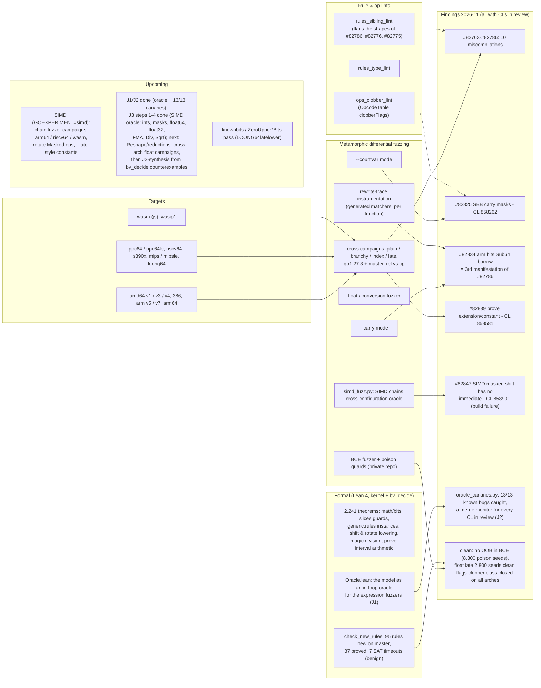

<h1>
  <picture>
    <source media="(prefers-color-scheme: dark)" srcset="assets/brand/lockup-dark.svg">
    
  </picture>
</h1>

**Finding correctness bugs in Go's standard library with Lean 4: a proof-of-concept.**

go-in-lean models a bounded subset of Go (fixed-width integers and, so far,
the whole of `math/bits`) in Lean 4, states the documented behaviour of each
function as a theorem, proves it with Lean's kernel and `bv_decide`, and
turns every failed proof into a concrete Go test that is run against the
pinned Go toolchain. A failed proof is never reported as a Go bug: every
model counterexample must reproduce in Go, and every reproduced discrepancy
is checked against known issues and left for human review.

> **About the name.** With a French ear, *go-in-lean* sounds suspiciously
> like *goéland* ("seagull"). This is either a carefully engineered bilingual
> pun, or what happens when your English is good enough to verify a compiler
> but not yet good enough to know the word *seagull*. We decided to call it
> branding.

It is inspired by [julia-in-lean](https://github.com/MilesCranmer/julia-in-lean)
and differs from [Gobra](https://github.com/viperproject/gobra)/[Viper](https://www.pm.inf.ethz.ch/research/viper.html)
and [Goose](https://github.com/goose-lang/goose)/[Perennial](https://github.com/mit-pdos/perennial)
in targeting bit-precise, executable, kernel-checked models of *existing*
library code rather than annotated verification of new code (see
`docs/prior-art.md`).

## Status (2026-11-01)

The current upstream state of every issue and fix tracked by the project is
kept in [`docs/upstream-status.md`](docs/upstream-status.md).

| | |
|---|---|
| Go version modelled | go1.25.5: all of `math/bits`; `slices.Compact/Index/Contains/Insert/Delete/Replace/Concat/Repeat`, `sort.Search`, `strings`/`bytes` `Repeat`/`Join` guards; 12 families of `generic.rules` + 74 generated constant folds; all 96 instances of the ARM64 and of the AMD64 shift-lowering rules, the rotate lowering rules of both; 64-bit targets |
| Lean | 4.35.0, no Mathlib, zero Lake dependencies |
| Properties registered | 76 (`targets/properties.yaml`) |
| Proved in model | 2,241 audited theorems (623 kernel-only, 1,618 `bv_decide`): `math/bits` in full, slices/sort/strings guards, 896 generated `generic.rules` instances (incl. bounds-check and rotate rules), 644 magic-division instances, ARM64/AMD64 shift and rotate lowering, the new `knownbits` pass and the interval arithmetic of `prove` on Go master, and the MIPS, riscv64, s390x, ppc64 and arm64 rules behind seven findings |
| Checked exhaustively, not proved | `slices.Insert/Delete/Replace` with aliasing: 531,531 configurations vs spec, 16,128 replayed through real Go |
| Metamorphic fuzzing | `scripts/metamorphic_fuzz.py`: constant vs run-time vs inlined versions of random integer expressions; 400 seeds (go1.27.3, master, amd64) and 2,160 seeds on nine other architectures under qemu (`scripts/cross_campaigns.sh`) |
| **Lean oracle in the fuzz loop (J1/J2)** | `lake exe oracle` evaluates generated integer expressions against the executable model (`Oracle.lean`: arithmetic, logic, shifts incl. the >= 2^63 class, conversions, min/max, and-not, math/bits intrinsics, rotate, comparisons, select, `bits.Add64`/`Sub64`, indexed array reads, and the divide/negative-shift/index panics); `scripts/oracle_bits.py` emits the same trees as a Go program and diffs. 300-seed hunt on go1.27.3 and tip: zero false positives. `scripts/oracle_canaries.py` runs the known-bug shapes as a directed suite: **13/13 caught** (the #82767 control stays clean on go1.27.3), across amd64/386, mipsle, ppc64le, riscv64, s390x, arm64, arm and power10 under qemu - each canary maps to its upstream CL, making the suite a merge monitor for every fix in review (`docs/fuzzing-vision.md`, `docs/cedar-notes.md`) |
| **Compiler bugs found** | (1) `((x >> c) & d) << e` rules compare constant counts as signed: wrong code in go1.25–1.27 and master; reported as [golang/go#82763](https://github.com/golang/go/issues/82763). (2) Master-only regression: shift-composition rules type the combined count with the shifted value's type and master's `prove` now trusts it: `(int32(2) >> 1) >> (1<<62)` is 1 (spec 0); fix validated; reported as [golang/go#82767](https://github.com/golang/go/issues/82767), `findings/SSA-COMPOSE-CONST64-TYPE` |
| **Architecture-specific miscompilations** | (3) mips/mipsle: `Rsh8x*` sign-extends from bit 15 (since go1.8; [golang/go#82772](https://github.com/golang/go/issues/82772)). (4) riscv64, go1.26 regression: `int8(x - (-x)) >> 8` compiles to 0 ([golang/go#82773](https://github.com/golang/go/issues/82773)). (5) s390x, since go1.26: `uint64(int8(-128)) < 0xFFFFFFFF` is true ([golang/go#82774](https://github.com/golang/go/issues/82774)). Fixes validated on master; reported after human review |
| **Reported 2026-11-02 (second batch)** | (6) ppc64/ppc64le: `int32(int16(x >> 1))` keeps 32 bits, `Type.Size()` compared in bits ([golang/go#82775](https://github.com/golang/go/issues/82775)). (7) mips/mipsle: constant counts ≥ 2^32 truncated, `(x >> 7) >> (uint64(y) \| 0xFFFFFFFF)` is `x >> 6` ([golang/go#82776](https://github.com/golang/go/issues/82776)). (8) arm64 (native): a constant-condition select of `^y` returns `y ^ 1` ([golang/go#82777](https://github.com/golang/go/issues/82777)). (9) ppc64le/ppc64 `GOPPC64=power10`: `math/bits.ReverseBytes16` mistyped as 64-bit miscompiles a comparison ([golang/go#82782](https://github.com/golang/go/issues/82782)); canary+objdump confirm wrong-code, not out-of-bounds. (10) arm: `MVNshiftRA` constant fold drops the complement, `bits.TrailingZeros64(0)` can be 32 ([golang/go#82786](https://github.com/golang/go/issues/82786)). Fixes validated on master; reported after human review |
| **Reported 2026-11-03 (third batch)** | (11) amd64/386: the SBB carry masks are not marked `clobberFlags`, so a comparison of a shift count against the width sharing the CMP flags reads them clobbered - `x << y` with `y == 64` miscompiles on go1.24.13..master ([golang/go#82825](https://github.com/golang/go/issues/82825), [CL 858262](https://go-review.googlesource.com/c/go/+/858262); all four widths and the `==`/`!=`/`>`/`<=` operators covered by the count-variable fuzzer mode). (12) arm: `bits.Sub64` inlined as its source formula drops the `^x_hi & y_hi` term of the borrow extraction during `lower` - a wrong `borrowOut` on go1.21.13..master ([golang/go#82834](https://github.com/golang/go/issues/82834)). (13) prove carries a fact through an extension with a constant too wide for the narrow type, truncating it: a branch that cannot be taken is taken on go1.26.6+ ([golang/go#82839](https://github.com/golang/go/issues/82839), [CL 858581](https://go-review.googlesource.com/c/go/+/858581)). All found or root-caused with the new `--countvar`/`--carry` fuzzer modes and the OpcodeTable flags lint |
| **Reported 2026-11-03 (fourth batch)** | (14) amd64 AVX-512, `GOEXPERIMENT=simd`: `x.ShiftAllLeft(c).IfElse(m, y)` fails to build at the 512-bit variant - the IfElse-of-a-shift fusion drops the aux shift count and the assembler rejects `VPSLLQ Z0, K1, Z1`; all 16/32/64-bit integer vector types, both shift directions ([golang/go#82847](https://github.com/golang/go/issues/82847), [CL 858901](https://go-review.googlesource.com/c/go/+/858901), in review). Found by the new SIMD chain fuzzer (`scripts/simd_fuzz.py`, cross-configuration oracle) |
| **The float rounding kernel is proved** | `GoInLean/Properties/FloatRounding.lean`: `shiftRound` - the single rounding step every `encode`, division and square root of the IEEE 754 models goes through - is proved to be the *unique* nearest-even rounding of `m / 2^k` (`RoundEvenNat`: within half an ulp, ties only onto even), kernel-checked with no `bv_decide` and no extra axiom (`#print axioms` shows only propext, Classical.choice, Quot.sound). The ProofKit direction, step 0 (docs/prior-art.md 2.8): the certification layer over the differentially-validated models |
| **SIMD spec oracle (J3, steps 1-5)** | `lake exe oracle-simd` evaluates generated SIMD chains against the documented `simd` package semantics at the 128-bit size: integer and mask types first (step 1), then `Float64s` over a full executable IEEE 754 binary64 model (`GoInLean/Semantics/Float64.lean`: round-to-nearest-even, subnormals, inf/NaN, and a fused single-rounding `fmaBits` - the spec side of [golang/go#80355](https://github.com/golang/go/issues/80355)), then `Float32s` over its binary32 mirror (`GoInLean/Semantics/Float32.lean`), and Div/Sqrt in both widths - single rounding at the final grid, validated against the correctly-rounded hardware (ties included). `scripts/simd_oracle.py` emits the same chains as `simd` package code; acceptance in both widths: `MulAdd((1+2^-w'), (1+2^-w'), -(1+2^(1-w')))` fuses on hardware and in the oracle and gives 0 under `GODEBUG=simd=0` - the documented emulated-unfused bug, seen by the spec-side oracle alone. The `--float` campaign (100 seeds, f64+f32, with Div/Sqrt) is clean on amd64 hardware except the four documented amd64 Min/Max NaN and +-0 deviations, and the emulated path diverges on 53/100 seeds = organic #80355 detection. The cross-arch campaign (7 GOARCHes under qemu on GEEKR9, GOEXEC/GO_ONLY/GO_FROM_FILE split flow) maps #80355 per target - fused by native paths and by FMA-contracting 64-bit emulations, double-rounded on 386/arm/mipsle and on amd64 GOAMD64=v1/v2 emulation - and found two gaps of CL 799281: the midway bridge is not regenerated, and its float32 form double-rounds (`findings/SIMD-BRIDGE-MULADD-GOAMD64`, one-ulp counterexamples); review comment published on the CL and the complete fix mailed as [CL 858921](https://go-review.googlesource.com/c/go/+/858921). Step 5 adds the lane reductions and the remaining arithmetic: ReduceSum (the floats pin the documented pairwise summation order `((x[0]+x[1])+(x[2]+x[3]))`, the ints wrap at the lane width), AddSaturated/SubSaturated, Average `((x+y+1)/2` toward +Inf), RotateAllRight and OnesCount. Mixed-mode campaign over 100 seeds x 2 configurations on the patched tree: clean on hardware and emulation except the known #82745 build failures and the documented amd64 Min-NaN deviation; the float ReduceSum tree matches the hardware bit for bit. Cross-arch (7 GOARCHes under qemu, 50 seeds x 2 configurations): the new ops conform everywhere - the only divergences are the known unfused-MulAdd seeds of golang/go#80355 on the 32-bit emulated paths of the pre-fix tree |
| Cross-implementation control | `scripts/alt_compiler_diff.py`: the same programs through gc, gccgo, TinyGo, LLGo and Yaegi, arbitrated by the Lean oracle. 2,000 programs on amd64 (2026-11-05): gc, gccgo, TinyGo and LLGo clean; one tip divergence = #82767 rediscovered; a Yaegi shift-count bug ([traefik/yaegi#1750](https://github.com/traefik/yaegi/issues/1750)). The directed suite reproduces #82763/#82825/#82839 with all five alternatives siding with the spec against gc. Under qemu on arm64, arm, mipsle, ppc64le, riscv64 and s390x (cross gccgo and TinyGo), every architecture-specific canary is corroborated by the alternatives, and the random suites surfaced a go1.26 arm64/loong64 spurious panic ([#82873](https://github.com/golang/go/issues/82873)) and the unbackported ppc64 fix of [#81842](https://github.com/golang/go/issues/81842) (`docs/research-report.md` 3.15-3.16). The `ext` suite aims at extension elision (identity detours such as `x &^ (y ^ y)` that only `-N` builds lower intact, nested conversions, `narrow(wide(e) >> c)`); it hits the [#36897](https://github.com/golang/go/issues/36897) trigger in about 1.7 % of programs, against 2 in 101,800 for the general suites (3.19) |
| Other discrepancies | `strings`/`bytes` `Join` conservative overflow guard (`unsafe` only, negligible); two latent rules wrong for unreachable counts (AMD64 `CMPLconst (SHRLconst _ [32])`, generic rotate recognition with a count ≥ 2^63) |
| Known issues reproduced | golang/go#54255, golang/go#15175 |
| Mutation test | 8 mutants refuted in Lean and reproduced in Go |

## Research map

Past and planned exploration axes, and what each found (2026-11):



Axes interact: the lints name the defect class, the fuzzer modes find instances
organically, the formal layer proves the fixes sound, and the rewrite-trace
instrumentation isolates root causes (it resolved #82834 as a third face of
#82786).

### Symbolic and concolic input selection

The random campaigns check each generated function on a handful of inputs, so a
miscompilation that only shows on particular values can be missed. Go has no mature
concolic tester (the native fuzzer is coverage-guided; `-gcflags=-d=libfuzzer` only adds
comparison tracing, without a solver), but the generated functions are small, loop-free
fixed-width integer expressions, which is the case where symbolic methods are cheap and,
for equivalence, exhaustive. Approaches, with their status:

| Approach | Idea | Status |
| --- | --- | --- |
| SMT boundary inputs (`--inputs smt`) | `scripts/smt_inputs.py` encodes the IR in z3 bit-vectors (Go semantics of shifts, division, conversions, `math/bits`) and solves, per function, for inputs on its semantic boundaries: shift counts at `w-1`/`w`/0, `MinInt / -1`, divisors of +-1, equal or adjacent comparison operands, both arms of each select (with the path condition), narrowing conversions that drop set bits, wrapping arithmetic. The Lean oracle stays the arbiter, so an encoding error costs coverage, not a false report. | Implemented, cross-checked against gc on 3,331 evaluations. A/B on 8,500 programs: 42 failing cases vs 48 for the pool (37 vs 41 for `--inputs mixed` on ppc64le/mipsle), within noise: the known bugs depend on expression shape more than on input values, so the pool stays the default (`docs/research-report.md` 3.17) |
| Per-function symbolic equivalence | Lift each compiled `vN` from the binary (angr/pyvex supports amd64, arm64, ppc64, mips, riscv64, s390x), and ask an SMT solver whether some `(x, y)` makes it differ from the IR. SAT gives a counterexample to confirm with the oracle and qemu; UNSAT proves that function correct for all inputs on that target. | Not tested |
| Concolic execution of gc binaries | SymQEMU (with AFL++ or LibAFL) or angr in concolic mode on whole programs. The Go runtime (stack growth, register ABI, scheduler) makes whole-program exploration hard; restricting it to the leaf `vN` functions avoids most of it. | Not tested |
| Compiler-level concolic testing of TinyGo / LLGo / gollvm | These emit LLVM IR, so SymCC (concolic, compiled in) or KLEE (symbolic) apply in principle. The runtime (GC, goroutines, syscalls) needs a reduced model; TinyGo's is the smallest. | Not tested |
| Per-pass translation validation of gc's generic SSA (`scripts/ssa_tv.py`) | Dump a function's SSA after every generic pass (`-d=ssa/all/dump`, `build` up to `lower`), encode each dump in z3, and check for all inputs at once: consecutive passes agree (outcome and value), the facts the IR claims hold (bounded shifts, `MinInt / -1` excluded by a `[true]` division, nonzero divisors where reached), and each value's type matches its op width (a narrower type is accepted only when z3 proves the value always fits it, as for the shifts `divmod.rules` types `int8`). A failure names the pass and gives a counterexample. | Prototype: finds #82767 (tip, at `opt`), #82873 (go1.26 arm64, at `build` and `prove`) and #82782 (Power10, at `build` and `prove`), nothing on the fixed toolchains. 14,400 generated functions (go1.27.3 and tip, six 64-bit targets): 71,576 pass pairs checked, no false report, 1.2 % unsupported; only finding #82782 (7 functions). `--lowered` extends it to the ppc64 passes from `lower` to `flagalloc` (about 80 PPC64 ops, ISA-undefined bits as free variables): it finds #82775 at `lower`, with counterexamples that qemu-ppc64le reproduces exactly, and nothing else on 4,800 function checks. The same for amd64 (about 150 ops, x86-64 register rules), with `--gcflags "-N -l"` for debug builds (stack slots modelled byte by byte): it finds the #36897 trigger at `lower` and nothing on 4,800 function checks of generated programs. riscv64 too (about 75 ops): it finds #82773 at `lower`. Other architectures' lowered passes, heap memory, loops and 32-bit targets out of scope (`docs/research-report.md` 3.18) |
| Translation validation of SSA rewrite rules | Alive2-style checking of each `.rules` rewrite, with the operand types and widths it is applied at. `check_new_rules` (Lean, `bv_decide`) already does this for rules new on master; extending it to all rules per architecture is the systematic version. | Partly done (new rules only) |
| Counterexample-guided synthesis | Turn `bv_decide` counterexamples for a suspicious rule into Go programs that exercise it (J2-synthesis in the research map). | Planned |
| Constant / opaque twin programs | Emit each generated function twice, once with its operands as compile-time constants and once behind `//go:noinline` and run-time inputs, and compare: constant folding and code generation must agree. Concolic.jl met this class in Julia (runtime and codegen disagree on wide shift counts), and #82776 is a Go instance. | Not tested |
| Concolic testing of the standard library | DART-style exploration over `golang.org/x/tools/go/ssa`, as Concolic.jl does over Julia's typed IR, aimed at value-dependent bugs in library code (`math/bits`, `strconv`, `slices`, `math/big`: overflow at `MinInt`/`MaxInt`, empty inputs). Concolic.jl's experience matches the A/B above: concolic search pays off on input-dependent library bugs, not on miscompilations, which depend on expression shape. Go's native fuzzing already covers part of this ground. | Not tested |
| Concolic exploration of the compiler itself | Explore the rewrite functions of `cmd/compile/internal/ssa` concolically to reach rarely matched rules. Large state space; a research project rather than a campaign. | Idea only |

## Quick start

Prerequisites: [elan](https://github.com/leanprover/elan) (installs Lean
4.35.0 from `lean-toolchain`), Go 1.25.x, Python 3 (standard library only).
With Nix: `nix develop` provides elan, Go and Python.

```sh
lake build                 # models, specifications, proofs (≈1 min)
lake exe audit             # axioms used by every theorem (kernel / bv_decide tiers)
scripts/check.sh           # everything CI runs, see below
```

`scripts/check.sh` runs, in order: banned-tactic source scan; regeneration
check of the generated files (Go lookup tables, constant-folding theorems);
`lake build`; axiom audit; `go vet` and the Go property tests (math/big
oracle, exhaustive 8/16-bit checks, boundary values); differential vectors
(47k inputs computed by Go, re-evaluated by the Lean models); bounded
exhaustive slice search and Go replay of 16k aliasing configurations;
manifest validation; mutation test (5 mutants → `bv_decide` counterexamples
→ generated Go reproducers → `go test`).

## Layout

```
GoInLean/Semantics/     Go integer semantics (BitVec + panics), validation, oracle specs
GoInLean/Stdlib/        transliterated Go code (+ generated tables)
GoInLean/Properties/    theorems, one per manifest entry
GoInLean/Audit.lean     axiom audit executable
GoInLean/CheckVectors.lean  differential checker executable
mutants/                deliberately wrong models (success criterion 6)
go/tests/               Go property tests and vector generator
go/reference/           Go twins of the mutants
go/reproducers/         generated reproducers (one per Lean counterexample)
targets/properties.yaml property manifest with status history
findings/               reproduced findings awaiting human review (none yet)
scripts/                check.sh, gen_bits_tables.py, validate_manifest.py, mutation_test.py,
                        gen_brand.py (visual identity)
docs/                   prior-art, semantic-boundary, architecture, compiler feasibility, report, brand
assets/brand/           logo, lockups, favicon, social preview (generated, see docs/brand.md)
```

## Reading the results

* `proved_in_model` means the *transliterated algorithm* satisfies the
  specification; the model is tied to Go by differential testing and
  reviewable line-by-line transliteration, not by proof
  (`docs/semantic-boundary.md`, assumption A4 on compiler intrinsics).
* Theorems proved with `bv_decide` rely on a per-theorem native-evaluation
  axiom (`…._native.bv_decide.ax_…`, the verified LRAT checker run through
  the compiler); `lake exe audit` reports the tier of every theorem.
  `native_decide` and `sorry` are banned.
* `docs/research-report.md` lists every property investigated with its
  classification, the limitations, and the prioritised next steps.

## Contributing

See `AGENTS.md` for commit conventions. Do not file upstream Go issues from
pipeline output without human review of the finding directory.

**Scope of upstream contributions.** go-in-lean is a personal project, run on
the author's own time and hardware out of interest in free software. Those
means cover finding defects, reducing them, and reporting them upstream with a
reproducer and an analysis. They do not cover writing, testing and maintaining
fixes for every project concerned: a report is not an offer of a pull request.
Fixing a confirmed defect, and deciding how, remains the responsibility of the
maintainers of the affected project. When a fix is already prepared during
the analysis (as for several Go CLs), it is offered as a courtesy, not as a
commitment. The analyses are AI-assisted and can be wrong, or partly debatable,
despite the checks described here; maintainers who find a report mistaken or
questionable in any part are kindly asked to say so courteously, and it will be
corrected or withdrawn.

## Licence

MIT (see `LICENSE`). Transliterated Go code and generated tables are
derived from Go sources under the BSD 3-Clause licence (see `NOTICE`).
