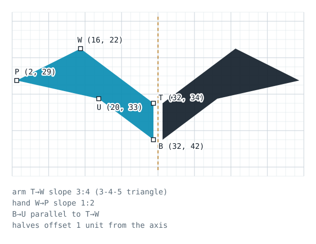
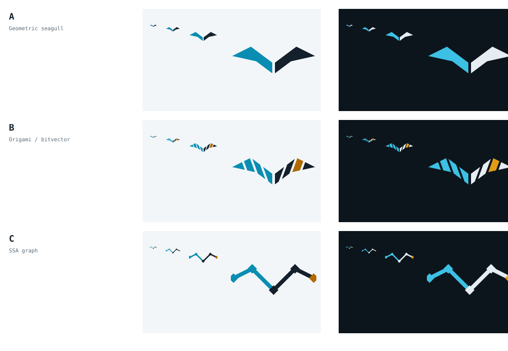

# Visual identity



## Idea

*go-in-lean* sounds like the French **goéland**: a seagull, which watches from
height and spots what doesn't belong. The mark is a gull in flight reduced to
two mirror-image wings:

* the **left wing, in cyan**, stands for Go: the implementation as it runs;
* the **right wing, in ink**, stands for Lean: the model and its specification;
* the **axis** between them is the claim being checked: the two sides are the
  same shape. The gap stays visible on purpose. The model and the code are tied
  by proofs *about the model* and by differential testing, not by identity
  (`docs/semantic-boundary.md`).

The mark does not imply that a whole compiler is verified, and it should not
be used to suggest that.

## Construction

The geometry is generated by `scripts/gen_brand.py`. Every vertex is an
integer point on a 64 × 64 grid:

| Point | Coordinates | Rule |
|---|---|---|
| T (shoulder) | (32, 34) | top of the axis |
| W (wrist) | (16, 22) | T + 4·(−4, −3): leading edge of the arm, slope 3:4 (a 3-4-5 triangle) |
| P (wing tip) | (2, 29) | W + 7·(−2, 1): leading edge of the hand, slope 1:2 |
| B (body) | (32, 42) | bottom of the axis, 8 units below T |
| U (wrist, trailing) | (20, 33) | B + 3·(−4, −3): trailing edge parallel to the leading edge |

The right wing is the mirror image x ↦ 64 − x. Each half sits 1 unit off the
axis. The favicon uses an *optical-size* cut (arm 12 units thick instead of 8)
so that the wings survive pixel snapping at 16 and 32 px.

The wordmark is a monoline lowercase drawn on the same grid, not a font:
x-height 20, ascender 28, descender 8, 45° chamfers of 4, stroke 3.6. There is
no font dependency and no third-party glyph outline in any file.

## Colour

| Role | Light background | Dark background |
|---|---|---|
| Go half of the mark | Cyan `#0A8DB3` (3.8:1 on white) | Cyan `#3CC0E4` (8.6:1 on `#0D151C`) |
| Lean half, wordmark, text | Ink `#14202B` (16.5:1) | Mist `#E6EDF2` (15.6:1) |
| Secondary text | Slate `#5B6B78` (5.5:1) | Slate `#8FA1AE` (6.9:1) |
| Background | Paper `#FFFFFF` | Night `#0D151C` |
| Signal: counterexamples, findings | Amber `#B06A00` (4.3:1) | Amber `#E39B17` (7.9:1) |

Ratios are WCAG 2 contrast ratios against the background in the same column.
Cyan is a graphic colour (≥ 3:1). Do not use it for body text on white.
**Amber is reserved for counterexamples and reproduced findings** in diagrams
and slides. Never use it as decoration, so that it keeps meaning "something
disagrees here".

## Files

All in `assets/brand/`, regenerated by `python3 scripts/gen_brand.py --png`
(PNGs need `rsvg-convert`). `scripts/check.sh` verifies the SVGs are up to date.

| File | Use |
|---|---|
| `lockup.svg`, `lockup-dark.svg` | README header, slides, article title blocks |
| `mark.svg`, `mark-dark.svg` | the symbol alone, transparent background |
| `mark-mono-black.svg`, `mark-mono-white.svg` | one-colour print, embossing, overlays on photos |
| `favicon.svg` | site favicon; switches colours with `prefers-color-scheme` |
| `avatar.svg`, `png/avatar-512.png` | square avatars (GitHub, chat): the mark on paper, no container shape |
| `social-preview.svg`, `png/social-preview.png` | GitHub social preview, 1280 × 640 (upload under *Settings → General → Social preview*) |
| `png/mark-512.png`, `png/mark-dark-512.png`, `png/favicon-32.png`, `png/apple-touch-icon.png` | raster fallbacks |
| `construction.svg` | the drawing at the top of this page |
| `exploration/` | concepts A, B, C and the comparison sheet: a record, not for use |

In GitHub Markdown, switch lockups with the theme:

```html
<picture>
  <source media="(prefers-color-scheme: dark)" srcset="assets/brand/lockup-dark.svg">
  
</picture>
```

## Usage

* Keep clear space of at least one wing-arm thickness (8 grid units) around
  the mark.
* Minimum size: 16 px wide for `favicon.svg`, 24 px wide for `mark.svg`, 120
  px wide for the lockup.
* Do: use the two-colour mark on Paper or Night, the mono marks elsewhere.
* Don't: put the mark in a rounded square or circle, add gradients, shadows or
  3D effects, recolour one wing only, swap the sides, close the gap at the
  axis, rotate it, or rebuild the wordmark in another typeface.
* Don't imitate the Go gopher, the Go wordmark or the Lean logo next to the
  mark. go-in-lean is an independent project, not affiliated with or endorsed
  by the Go project, Google, or the Lean FRO.

## Concepts explored



* **A. Geometric seagull** (retained). Two mirror-image wings on rational
  slopes. It is the clearest silhouette at 16 px, it works in one colour, and
  the symmetry carries the project's central idea (implementation and model
  should agree) without a symbol or operator.
* **B. Origami / bitvector.** The same silhouette cut into eight facets, a
  byte, with one flipped bit in signal amber: a counterexample. It is a good
  story, but the cuts disappear below 32 px, and putting a "bug" in the logo
  overstates how often one is found. It is kept as an illustration motif for
  talks about findings.
* **C. SSA graph.** The wing skeleton as a value graph with diamond nodes and a
  counterexample at one wing tip. It is distinctive at large sizes but thin
  and fragile as an icon. It could serve as a diagram style for SSA rewrite
  rules.

## Licence

The mark, wordmark and files in `assets/brand/` are original work generated by
`scripts/gen_brand.py` and are distributed under the repository's MIT licence
(`LICENSE`). They contain no material derived from the Go or Lean logos.
